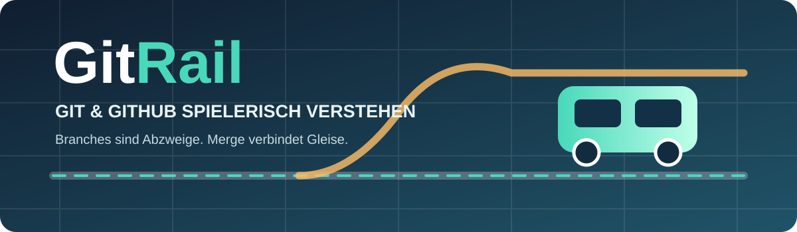
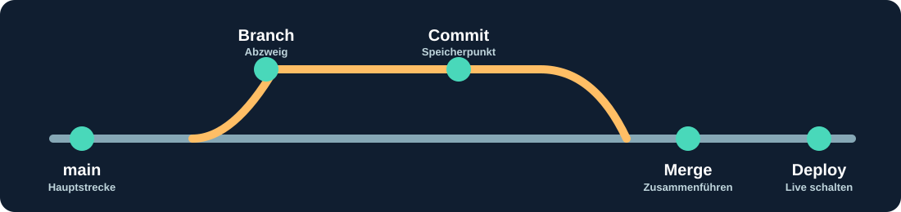

<!-- GitRail / Michael Gahn DESIGN -->
<p align="center"></p>
<p align="center">
  
  
  
  
  
  <a href="https://michael-gahn.de"></a>
</p>

<p align="center">
  <a href="https://michaelgahndesign.github.io/GitRail_Webapp/"><strong>🚂 ▶ GitRail – DEMO IM BROWSER STARTEN</strong></a>
  &nbsp;·&nbsp;
  <a href="https://github.com/MichaelGahnDESIGN/GitRail_Webapp/actions/workflows/pages.yml">Demo-Build prüfen</a>
</p>

> [!IMPORTANT]
> **Demo-Freischaltung:** In **Settings → Pages → Build and deployment → Source** muss **GitHub Actions** gewählt sein. Danach den Workflow **GitRail – Browser-Vorschau (GitHub Pages)** unter **Actions** erneut starten. Bis zur erfolgreichen Veröffentlichung öffnet der Demo-Link noch nicht das Spiel.

# 🚂 GitRail – Git lernen auf Schienen

> **Branches sind Abzweigungen. Commits sind Speicherpunkte. Merges verbinden Entwicklungsstände.**
>
> GitRail verwandelt abstrakte Git- und GitHub-Begriffe in eine interaktive Eisenbahn-Lernwelt – mit Missionen, Weichen, Baustellen und verständlichen Erklärungen. Entwickelt mit **Flutter Web**, vollständig ohne Datenbank und mit statischem Hosting auf all-inkl.



## ✨ Warum GitRail?

Wer Websites programmiert, versteht Header, CSS und Deployments – aber Git-Begriffe wie `worktree`, `pull request` oder `merge` wirken zunächst abstrakt. GitRail erklärt sie durch ein konsistentes Eisenbahnmodell. **Die Metapher erleichtert den Einstieg, die fachliche Erklärung sorgt für echtes Verständnis.**

## 🎮 Bereits spielbarer Prototyp (v0.1.0)

| Funktion | Status |
| --- | --- |
| Flutter-WebApp mit deutscher Oberfläche | ✅ Implementiert |
| Interaktive Lernmissionen | ✅ 11 Lektionen |
| Bahnhofswörterbuch (Git → Zug-Metapher) | ✅ Implementiert |
| Visueller Gleisplan | ✅ Flutter CustomPainter |
| Sofortiges Feedback + XP | ✅ Für die aktuelle Sitzung |
| Mobile-freundliche Oberfläche | ✅ Grundlayout |
| Automatischer Web-Build über GitHub Actions | ✅ Konfiguriert, Build-Status prüfen |
| Fortschritt nach Seiten-Neuladen speichern | 🗓️ Geplant |
| Interaktiver Gleisbau: Branch → Commit → Merge | ✅ Erster Prototyp (Drag + Buttons) |
| Multiplayer / KI-Agent-Simulation | 🗓️ Geplant |
| Echte Git-Operationen | ❌ Nicht vorgesehen für die erste Version |

> [!NOTE]
> Dies ist ein **erster interaktiver Gleisbau-Prototyp** mit Weiche, Branch, Commit und Merge sowie elf Quiz-Missionen. Vollständig frei platzierbare Gleise, Mehrzugverkehr und echte Konfliktszenarien folgen später.

## 🚉 Lernstationen

| Bahnhof | Git-Begriff | Bahn-Bild |
| --- | --- | --- |
| 1 | `main` | Hauptstrecke |
| 2 | `commit` | Baufortschritt festhalten |
| 3 | `branch` | Abzweigung |
| 4 | `push` | Zur Zentrale hochladen |
| 5 | `pull` | Neue Pläne holen und integrieren |
| 6 | `pull request` | Antrag zum Zusammenführen |
| 7 | `merge` | Strecken zusammenführen |
| 8 | `worktree` | Eigener Bauhof |
| 9 | Merge-Konflikt | Widersprüchliche Baupläne |
| 10 | `deploy` | Strecke für Besucher eröffnen |
| 11 | `.gitignore` | Ausschlussliste |

**Wichtige Präzisierung:** `Push` ist nicht dasselbe wie `Deploy`. `main` ist nicht zwingend der Live-Stand. Zwei getrennte Branches allein schützen nicht vor gleichzeitigen Änderungen im **selben Arbeitsverzeichnis**.

## 🛠️ Lokal starten

Flutter SDK installieren, anschließend im geklonten Repository:

```bash
flutter create . --platforms web
flutter pub get
flutter run -d chrome
```

Falls Chrome nicht verfügbar ist, zeigt `flutter devices` mögliche andere Ziele. Der Befehl `flutter create . --platforms web` ergänzt die von Flutter generierten Plattform- und Projektdateien, soweit sie noch fehlen.

### Checks

```bash
flutter analyze
flutter test
flutter build web --release
```

### Web-Build auf all-inkl veröffentlichen

**Keine MySQL-Datenbank und kein Backend erforderlich.**

1. `flutter build web --release` ausführen.
2. Den **Inhalt** von `build/web/` in das Webroot der Domain/Subdomain bei all-inkl hochladen.
3. HTTPS aktivieren und Domain im Browser testen.

Bei Veröffentlichung in einem Unterordner: `flutter build web --release --base-href /gitrail/`. Siehe [all-inkl-Anleitung](docs/HOSTING_ALL_INKL.md).

## 🗂️ Projektaufbau

```text
GitRail_Webapp/
├── assets/
│   ├── banner.svg
│   └── rail-workflow.svg
├── lib/
│   ├── main.dart                # Spielprototyp
│   └── rail_lab.dart            # Interaktiver Gleisbau
├── test/
│   └── widget_test.dart         # UI-Grundtest
├── web/
│   └── index.html
├── docs/
│   ├── WIKI_HOME.md             # Wiki-Startseite
│   ├── SPIELDESIGN.md           # Game Design Document
│   ├── ARCHITEKTUR.md           # Technischer Aufbau
│   └── HOSTING_ALL_INKL.md      # Deployment ohne MySQL
├── .github/workflows/
│   └── flutter-web.yml          # Analyse, Tests, Web-Artefakt
├── AGENTS.md                    # Agentenregeln für Codex
├── CLAUDE.md                    # Claude-Code-Anweisungen
├── pubspec.yaml
└── README.md
```

## 📚 Dokumentation / Wiki

- [Wiki-Startseite](docs/WIKI_HOME.md)
- [Spielkonzept, Level und Roadmap](docs/SPIELDESIGN.md)
- [Flutter-Architektur](docs/ARCHITEKTUR.md)
- [Hosting bei all-inkl](docs/HOSTING_ALL_INKL.md)
- [Agentenregeln für Codex und Claude](AGENTS.md)

Ein separates GitHub-Wiki benötigt eine eigene Wiki-Verwaltung. Die Dokumentation im Repository funktioniert unabhängig davon und lässt sich direkt verlinken.

## ♿ Barrierefreiheit, Datenschutz und Sicherheit

- Keine Anmeldung, kein MySQL, keine Telemetrie im Prototyp.
- Spielstand aktuell nur im flüchtigen Sitzungsspeicher – kein dauerhafter Fortschritt.
- Ziel: Tastaturbedienung, ausreichende Kontraste, reduzierte Animation bei entsprechender Systemeinstellung.
- Kein automatischer Zugriff auf echte Git-Repositories der Spielenden.
- Keine Zugangsdaten in Quellcode oder Git.

## 🛣️ Roadmap

**v0.2:** Interaktiver Weichen-Prototyp vorhanden; als nächstes frei verlegbare Gleise, mehrere Züge und Konfliktsimulation.  
**v0.3:** Lokaler Spielstand, Kapitelkarte, Auszeichnungen.  
**v0.4:** Zwei Bautrupps / KI-Agents und Worktree-Konflikte.  
**v1.0:** Umfangreiche Kampagne, Accessibility-Prüfung, deutsch-/englischsprachig und PWA-Ausbau.

## 🤝 Mitentwicklung

Pull Requests willkommen. Bitte vor Änderungen [AGENTS.md](AGENTS.md) und [das Game Design Document](docs/SPIELDESIGN.md) lesen. Der wichtigste Maßstab ist verständliche **und technisch korrekte** Wissensvermittlung.

## 📄 Lizenz

[MIT License](LICENSE) · © 2026 Michael Gahn DESIGN

---

<p align="center"><strong>GitRail · Der Weg von der ersten Abzweigung zum sicheren Merge. 🚂</strong></p>
